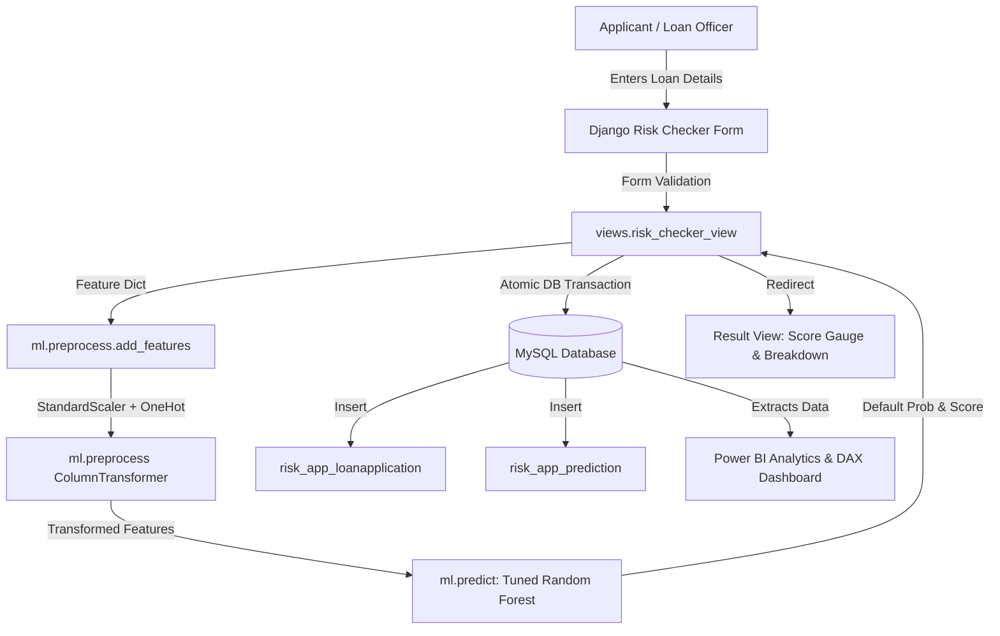

# RiskWise — FinTech Credit Risk Scoring & Loan Default Predictor

An enterprise-grade, machine-learning-powered credit risk assessment and loan default prediction platform built with Python, Django, MySQL, Scikit-learn, and Power BI.

> **Live Demo**: <ADD LINK AFTER DEPLOY>

---

## 1. Project Title & Summary
**RiskWise** evaluates loan applicant creditworthiness and estimates default risk using real-world borrower financial data. The application automates underwriting risk classification, predicts statistical default probabilities (0.0% - 100.0%), derives custom credit risk scores (300 - 900), provides a responsive borrower portal, and features a comprehensive administrative risk analytics dashboard.

---

## 2. Problem Statement
Traditional loan underwriting often suffers from manual delays, subjective credit evaluations, and rigid legacy rule systems that misprice credit risk or exclude creditworthy borrowers. Financial institutions require data-driven, auditable automated scoring engines that can evaluate multi-dimensional applicant profiles in real time while maintaining strict regulatory transparency, user privacy, and portfolio-level risk monitoring.

---

## 3. Project Objectives
- Build an end-to-end FinTech credit risk scoring pipeline on real loan performance records.
- Train, evaluate, and tune multiple supervised machine learning classifiers to maximize discrimination power (ROC-AUC).
- Develop a full-featured Django web application with secure email authentication, borrower self-service, prediction history, and custom administrative analytics.
- Persist loan applications and prediction results in a normalized MySQL relational database.
- Prepare an executive Power BI reporting data model with validated DAX business measures for portfolio-level exposure analysis.
- Maintain rigorous software engineering standards with automated test coverage, strict input validation, and role-based access control.

---

## 4. Key Features
- **Credit Risk Checker**: Interactive loan assessment form capturing demographics, financial profile, loan intent, credit history, and interest rates.
- **Real-Time ML Prediction**: Instant calculation of loan default probability, RiskWise Credit Score (300-900), and categorical risk tier (Low, Medium, High).
- **Borrower Self-Service Portal**: User registration, email authentication, account management, password updates, and historical loan prediction tracking.
- **RiskWise Admin Hub**: Tailored administrative dashboard featuring portfolio KPIs, recent prediction feeds, interactive Chart.js visualizations, and compliance-ready CSV exports.
- **Model Intelligence**: Publicly accessible model performance view documenting evaluated metrics (ROC-AUC, Precision, Recall, F1) and ROC/Confusion Matrix charts.
- **Demo Data Generator**: Safe, idempotent management command generating ~200 synthetic demo predictions for benchmarking without touching real customer PII.
- **Power BI Reporting Engine**: Multi-page analytics data model with validated DAX formulas covering portfolio KPIs, demographic segmentation, and risk drivers.

---

## 5. Technologies & Their Roles
| Technology | Role | Version / Package |
| :--- | :--- | :--- |
| **Python** | Core backend language | 3.12+ |
| **Django** | Web framework, ORM, authentication & admin | 5.2+ |
| **MySQL** | Production relational database persistence | 8.0+ / `mysqlclient` |
| **Scikit-learn** | Machine learning preprocessing & model training | 1.6+ |
| **Pandas & NumPy** | Data ingestion, feature engineering & transformations | 2.2+ |
| **Matplotlib & Seaborn** | Exploratory Data Analysis & visual evaluation artifacts | Latest |
| **Bootstrap 5 & CSS3** | Responsive UI styling (Navy `#0B132B` & Teal `#14B8A6`) | 5.3+ |
| **Chart.js** | Client-side reactive charts in Django admin | 4.4+ |
| **Power BI Desktop** | Executive portfolio reporting, DAX measures & segmentation | Store Edition |

---

## 6. System Architecture & Application Workflow



---

## 7. Project Folder Structure
```
fintech-credit-risk/
├── config/                        # Django project configuration (settings, urls, wsgi)
├── dataset/                       # Raw & cleaned credit datasets (loan_data_cleaned.csv)
├── ml/                            # Machine learning pipeline
│   ├── predict.py                 # Real-time prediction function & score conversion
│   ├── preprocess.py              # Feature engineering & ColumnTransformer
│   ├── saved_models/              # Serialized model (.joblib) & evaluation JSON
│   └── train_model.py             # Model training script
├── notebooks/                     # Jupyter notebooks (EDA, feature engineering, training)
├── powerbi/                       # Power BI reporting architecture
│   ├── README.md                  # Dashboard overview & page specs
│   ├── data/                      # Exported sanitized reporting dataset (.csv)
│   ├── dax/                       # Validated DAX measures specification (.dax)
│   ├── documentation/             # Data model, visual specs & connector guides
│   └── screenshots/               # Visual evidence subdirectories
├── risk_app/                      # Core Django application
│   ├── admin.py                   # RiskWise custom admin customizations
│   ├── forms.py                   # Authentication & loan assessment forms
│   ├── management/commands/       # Seed commands & demo data generator
│   ├── models.py                  # User, LoanApplication, Prediction, LoanType
│   ├── tests.py                   # Automated 18-test verification suite
│   ├── urls.py                    # URL routing
│   └── views.py                   # Portal & assessment views
├── static/                        # CSS, JS, branding, and EDA/ML chart images
├── templates/                     # HTML templates (Home, About, Risk Checker, Admin)
└── requirements.txt               # Python project dependencies
```

---

## 8. Database Overview & Relationships
The relational schema in MySQL contains normalized tables:
- **`risk_app_user`**: Custom user model supporting email-based authentication and role flags (`USER` vs `ADMIN`).
- **`risk_app_loantype`**: Catalog of active loan purposes (`EDUCATION`, `MEDICAL`, `VENTURE`, `PERSONAL`, `HOMEIMPROVEMENT`, `DEBTCONSOLIDATION`).
- **`risk_app_loanapplication`**: Individual borrower application records including income, employment length, home ownership, grade, and loan amount.
- **`risk_app_prediction`**: ML outputs linked 1-to-1 to each application (`default_probability`, `credit_score`, `risk_level`, `predicted_status`).
- **`risk_app_contactmessage`**: Inbound support and user feedback inquiries.
- **`risk_app_modelinfo`**: Tracks active ML model metadata, accuracy, and ROC-AUC.

---

## 9. ML Pipeline Explanation
1. **Source Data**: Historical lending dataset comprising 32,409 cleaned loan records.
2. **Feature Engineering**:
   - `loan_to_income = loan_amnt / person_income`
   - `interest_to_income = (loan_amnt * loan_int_rate / 100) / person_income`
3. **Preprocessing Pipeline** (`ColumnTransformer`):
   - Numerical (`StandardScaler`): `person_age`, `person_income`, `person_emp_length`, `loan_amnt`, `loan_int_rate`, `cb_person_cred_hist_length`, `loan_to_income`, `interest_to_income`.
   - Ordinal (`OrdinalEncoder`): `loan_grade` (A to G), `cb_person_default_on_file` (N, Y).
   - Nominal (`OneHotEncoder`): `person_home_ownership`, `loan_intent`.
4. **Tuned Classifier**: Random Forest Classifier (`n_estimators=200`, `max_depth=16`, `min_samples_leaf=2`).
5. **Model Evaluation Metrics** (Verified on test split):
   - **ROC-AUC**: `0.9350`
   - **Accuracy**: `93.47%`
   - **Precision**: `97.43%`
   - **Recall**: `72.07%`
   - **F1 Score**: `0.8285`

---

## 10. Prediction and Score Interpretation
- **Default Probability**: Continuous statistical estimate between `0.0000` (lowest risk) and `1.0000` (highest risk).
- **RiskWise Credit Score**: Scaled custom score derived from probability:
  $$\text{Score} = \text{round}(900 - (\text{Probability} \times 600))$$
  - `780 - 900`: **Low Risk** (Favorable approval recommendation)
  - `600 - 779`: **Medium Risk** (Conditional approval / manual review)
  - `300 - 599`: **High Risk** (Elevated likelihood of default / rejection recommended)

> [!NOTE]
> The RiskWise Credit Score is an internal algorithmic risk gauge and is not an official FICO or credit bureau score.

---

## 11. Installation Prerequisites
- Python 3.10, 3.11, or 3.12
- MySQL Server 8.0+ running locally or remotely
- Git version control

---

## 12. Virtual Environment Setup
```powershell
# Clone the repository
git clone https://github.com/knd12-lad/fintech-credit-risk.git
cd fintech-credit-risk

# Create virtual environment
python -m venv venv

# Activate virtual environment (Windows PowerShell)
.\venv\Scripts\Activate.ps1
```

---

## 13. Dependency Installation
```powershell
pip install -r requirements.txt
```

---

## 14. Environment Variable Setup
Create a `.env` file in the project root based on `.env.example`:
```env
SECRET_KEY=your-django-secret-key-here
DEBUG=True
ALLOWED_HOSTS=127.0.0.1,localhost
DB_NAME=fintech_credit_risk
DB_USER=root
DB_PASSWORD=your_mysql_password
DB_HOST=127.0.0.1
DB_PORT=3306
```
*(Never share, commit, or expose your actual `.env` file).*

---

## 15. Database Configuration & Migrations
Ensure the MySQL database exists:
```sql
CREATE DATABASE fintech_credit_risk CHARACTER SET utf8mb4 COLLATE utf8mb4_unicode_ci;
```
Run Django migrations:
```powershell
python manage.py migrate
```

---

## 16. Initial Data Seeding
Populate standard loan purposes and model evaluation metrics:
```powershell
python manage.py seed_initial_data
```

---

## 17. Server Startup Instructions
```powershell
python manage.py runserver
```
Access the application at `http://127.0.0.1:8000/`.

### 17.1 Simultaneous Side-by-Side Testing (Admin + Borrower in Single Chrome)
To test both portals concurrently in Google Chrome without session cookie collisions:
* **Left Tab (Admin Portal):** `http://127.0.0.1:8000/admin/` (Login with Admin account)
* **Right Tab (Borrower Portal):** `http://localhost:8000/` (Login with Borrower account)

*(See [`DUAL_PORTAL_GUIDE.md`](file:///c:/fintech-credit-risk/DUAL_PORTAL_GUIDE.md) for complete step-by-step documentation)*

---

## 18. Test Execution Instructions
Run the automated 23-test verification suite:
```powershell
python manage.py test risk_app -v 2
```

---

## 19. Power BI Dashboard Explanation
The project includes a 3-page reporting model located in `powerbi/`:
- **Page 1 (Overview)**: Portfolio volume KPI cards, predicted high-risk percentage, average credit score, risk category distribution donut, and loan purpose volume.
- **Page 2 (Default Analysis)**: Multi-dimensional risk segmentation by Loan Grade (A-G), Loan Purpose, Annual Income Tiers (`<$25k` to `>$100k`), and Age Brackets (`18-25` to `51+`).
- **Page 3 (Applicants & Model Insights)**: Risk score histograms, default probability vs loan-to-income distributions, model metric cards, and a compliance audit detail view.

---

## 20. Application Visual Artifacts & Screenshots

### 20.1 UI & Dashboard Screenshots
| View | Description | Screenshot Placeholder |
| :--- | :--- | :--- |
| **Home Page** | Landing page with hero banner, feature overview & how it works | `` *(Add screenshot after deploy)* |
| **Credit Risk Checker** | Assessment form capturing borrower financial parameters | `` *(Add screenshot after deploy)* |
| **Prediction Result** | Calculated credit score gauge, default probability & risk tier | `` *(Add screenshot after deploy)* |
| **Admin Analytics Hub** | Portfolio KPI metrics, Chart.js charts & compliance log feed | `` *(Add screenshot after deploy)* |
| **Power BI Page 1** | Executive Portfolio Overview & exposure distribution | `` *(Add screenshot after desktop build)* |
| **Power BI Page 2** | Default Analysis segmented by Grade, Income & Purpose | `` *(Add screenshot after desktop build)* |
| **Power BI Page 3** | Applicants & Model Insights distribution & audit table | `` *(Add screenshot after desktop build)* |

### 20.2 Machine Learning Evaluation Artifacts
Real ML and EDA evaluation artifacts generated during model training:
- **Confusion Matrices**: `static/images/ml/01_confusion_matrices.png`
- **ROC Curves**: `static/images/ml/02_roc_curves.png`
- **Feature Importance**: `static/images/ml/03_feature_importance.png`
- **Correlation Heatmap**: `static/images/eda/05_correlation_heatmap.png`

---

## 21. Demo Data Explanation
To demonstrate portfolio analytics in Power BI and Django Admin, 200 synthetic demo predictions are pre-generated via:
```powershell
python manage.py generate_demo_predictions --limit 200 --execute
```
All demo records are clearly labeled as `Demo Applicant #XXX` and linked to `demo_portfolio@riskwise.internal`. They contain no real-world personal information.

---

## 22. Production Deployment (PythonAnywhere)
Follow these exact steps to deploy RiskWise to PythonAnywhere:

### Step 1: Clone Repository
Open a **Bash console** on PythonAnywhere and clone the repository:
```bash
git clone https://github.com/knd12-lad/fintech-credit-risk.git
cd fintech-credit-risk
```

### Step 2: Create Virtual Environment
Create and activate a virtual environment using Python 3.12:
```bash
mkvirtualenv --python=/usr/bin/python3.12 riskwise-venv
```
*(Or manually: `python3.12 -m venv ~/.virtualenvs/riskwise-venv && source ~/.virtualenvs/riskwise-venv/bin/activate`)*

### Step 3: Install Production Dependencies
```bash
pip install --upgrade pip
pip install -r requirements-prod.txt
```
> [!IMPORTANT]
> **Scikit-learn Version Sensitivity**: `requirements-prod.txt` pins `scikit-learn==1.9.1`. The serialized machine learning model in `ml/saved_models/credit_risk_model.joblib` must be run on the exact scikit-learn version it was compiled with to avoid deserialization errors.

### Step 4: Configure MySQL Database
1. Go to the **Databases** tab on PythonAnywhere.
2. Initialize your MySQL database instance if not already done.
3. Under **Create database**, create a database named `fintech_credit_risk` (full database name will be `yourusername$fintech_credit_risk`).

### Step 5: Configure Environment Variables
Create a production `.env` file in `/home/yourusername/fintech-credit-risk/.env`:
```env
SECRET_KEY=your-generated-random-secret-key-at-least-50-characters
DEBUG=False
ALLOWED_HOSTS=yourusername.pythonanywhere.com
CSRF_TRUSTED_ORIGINS=https://yourusername.pythonanywhere.com

DB_NAME=yourusername$fintech_credit_risk
DB_USER=yourusername
DB_PASSWORD=your_mysql_password
DB_HOST=yourusername.mysql.pythonanywhere-services.com
DB_PORT=3306

EMAIL_HOST=smtp.gmail.com
EMAIL_PORT=587
EMAIL_HOST_USER=your-email@example.com
EMAIL_HOST_PASSWORD=your-app-password
EMAIL_USE_TLS=True
```

### Step 6: Run Migrations and Seed Data
In the Bash console (with virtual environment active):
```bash
python manage.py migrate
python manage.py seed_initial_data
python manage.py createsuperuser
```

### Step 7: Collect Static Files
Compile static assets into `staticfiles/`:
```bash
python manage.py collectstatic --noinput
```

### Step 8: Configure PythonAnywhere Web Tab
1. Navigate to the **Web** tab on PythonAnywhere.
2. Under **Code**:
   - **Source code**: `/home/yourusername/fintech-credit-risk`
   - **Working directory**: `/home/yourusername/fintech-credit-risk`
3. Under **Virtualenv**:
   - Set path: `/home/yourusername/.virtualenvs/riskwise-venv`
4. Under **Static files**:
   - **URL**: `/static/`
   - **Directory**: `/home/yourusername/fintech-credit-risk/staticfiles/`

### Step 9: Configure WSGI File
Click on the WSGI configuration file link (`/var/www/yourusername_pythonanywhere_com_wsgi.py`), clear default content, and replace with:
```python
import os
import sys

path = '/home/yourusername/fintech-credit-risk'
if path not in sys.path:
    sys.path.append(path)

os.environ['DJANGO_SETTINGS_MODULE'] = 'config.settings'

from django.core.wsgi import get_wsgi_application
application = get_wsgi_application()
```

### Step 10: Reload Web App
Click the green **Reload <yourusername>.pythonanywhere.com** button at the top of the Web tab. Your application is now live!

---

## 23. Known Limitations
- **Synthetic Demo Data**: The ~200 demo applicants were generated using reproducible random sampling (`generate_demo_predictions --limit 200`) for demonstration and portfolio analytics; they do not contain real personal data.
- **Educational / Demonstrative Model**: RiskWise is an educational/demo project. Statistical default probabilities and RiskWise credit scores (300-900) are model estimates and must not be used for real lending decisions.
- **Manual Power BI Authoring**: Power BI Desktop (`PBIDesktopStore.exe`) runs inside a sandboxed client environment without CLI scriptability; `RiskWise_Dashboard.pbix` must be authored manually using the provided CSV dataset (`powerbi/data/riskwise_powerbi_dataset.csv`), theme (`powerbi/RiskWise_Theme.json`), and DAX formulas (`powerbi/dax/measures.dax`).

---

## 23. Privacy and Security Notes
- Password hashes use PBKDF2 with SHA-256 via Django's authentication system.
- Cross-Site Request Forgery (CSRF) tokens protect all state-changing POST requests.
- Strict user authorization ensures borrowers can view only their own prediction records.
- All administrative routes require verified staff credentials.
- Administrators can view an account's pages in read-only mode for support purposes; every such access is logged.

---

## 24. Admin: View Website as a User
RiskWise includes an audited "View Website as User" capability designed for borrower support:
- **Read-Only Mode**: During a view-as session, all state-modifying actions (assessments, profile edits, password changes, contact inquiries) are strictly blocked by `ViewAsReadOnlyMiddleware`.
- **Audited**: Every view-as start and exit event is immutably recorded in the compliance `ActivityLog` table with the administrator's identity, target user ID, timestamp, and IP address.
- **30-Minute Time Limit**: Hand-off tokens expire in 30 seconds, and the active session automatically expires after 30 minutes.
- **Dual-Session Isolation**: Backed by `SplitSessionMiddleware`, the administrator's admin session cookie (`rw_admin_sessionid`) remains active and untouched when entering, browsing, or exiting the borrower view.

---

## 25. Credits & References
- Dataset: Credit Risk Dataset (Kaggle / Lending Club derived loan records).
- Frameworks: Django Project, Scikit-learn, Bootstrap, Chart.js.
