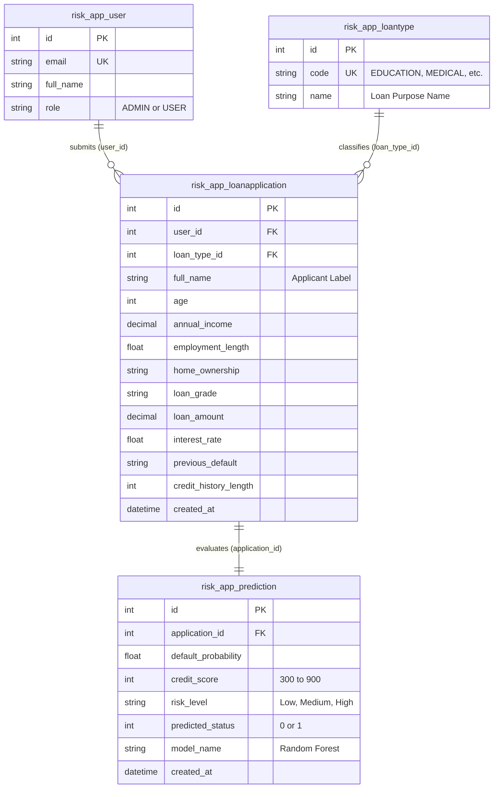

# RiskWise — Power BI Data Model & DAX Documentation

## 1. Data Model Architecture

The RiskWise reporting model can be implemented using either of two architectures:
1. **Consolidated Flat Star-Schema Table (`RiskWise_Portfolio`)**: Recommended for direct CSV import or single view query (`powerbi/data/riskwise_powerbi_dataset.csv`).
2. **Relational Schema (Direct MySQL Connection)**: Connecting directly to MySQL tables `risk_app_loanapplication`, `risk_app_prediction`, `risk_app_loantype`, and `risk_app_user`.

### Table Grains and Cardinalities
- **`LoanApplications`**: One row per loan application (Grain: `application_id`). Primary entity.
- **`Predictions`**: One row per ML prediction (Grain: `prediction_id`). 1-to-1 relationship with `LoanApplications`.
- **`LoanTypes`**: Dimension table of loan purposes (Grain: `loan_type_id`). 1-to-Many with `LoanApplications`.
- **`Users`**: Dimension table of portal users (Grain: `user_id`). 1-to-Many with `LoanApplications`.

---

## 2. Demographic & Financial Segmentation Bins

To enable structured multi-dimensional analysis on Page 2 and Page 3, categorical bins are established:

| Dimension | Tier / Bracket | Value Range | Purpose |
| :--- | :--- | :--- | :--- |
| **Age Groups** | `18-25` | 18 to 25 yrs | Young / Entry-level workforce |
| | `26-35` | 26 to 35 yrs | Early to Mid career |
| | `36-50` | 36 to 50 yrs | Prime earning career |
| | `51+` | > 50 yrs | Mature / Pre-retirement |
| **Income Tiers** | `< $25k` | $0 to $24,999 | Lower income bracket |
| | `$25k - $50k` | $25,000 to $49,999 | Lower-middle income |
| | `$50k - $75k` | $50,000 to $74,999 | Middle income |
| | `$75k - $100k` | $75,000 to $99,999 | Upper-middle income |
| | `> $100k` | >= $100,000 | Affluent / High net worth |
| **Loan Grades** | `A` to `G` | Ordered A (best) to G (highest risk) | Credit risk tiering |

---

## 3. Validated DAX Measures & Expected Baseline Values

All measures utilize safe division (`DIVIDE`) to prevent `#DIV/0!` errors.

| Measure Name | DAX Expression | Interpretation | Baseline Value (205 Records) |
| :--- | :--- | :--- | :--- |
| **Total Applications** | `COUNTROWS('RiskWise_Portfolio')` | Total loan assessment requests | **205** |
| **Total Loan Volume** | `SUM('RiskWise_Portfolio'[loan_amount])` | Total loan portfolio volume | **$2,863,275** |
| **Demo Records Count** | `CALCULATE(COUNTROWS('RiskWise_Portfolio'), 'RiskWise_Portfolio'[is_demo] = "Demo")` | Clearly labeled synthetic demo entries | **200** (97.6%) |
| **Real Records Count** | `CALCULATE(COUNTROWS('RiskWise_Portfolio'), 'RiskWise_Portfolio'[is_demo] = "Real")` | Genuine portal user submissions | **5** (2.4%) |
| **High-Risk Count** | `CALCULATE(COUNTROWS('RiskWise_Portfolio'), 'RiskWise_Portfolio'[risk_level] = "High")` | Borrowers evaluated as High Risk (Score < 600) | **34** (16.6%) |
| **Medium-Risk Count**| `CALCULATE(COUNTROWS('RiskWise_Portfolio'), 'RiskWise_Portfolio'[risk_level] = "Medium")`| Borrowers evaluated as Medium Risk (600 <= Score < 780)| **18** (8.8%) |
| **Low-Risk Count** | `CALCULATE(COUNTROWS('RiskWise_Portfolio'), 'RiskWise_Portfolio'[risk_level] = "Low")` | Borrowers evaluated as Low Risk (Score >= 780) | **153** (74.6%) |
| **Average Credit Score**| `AVERAGE('RiskWise_Portfolio'[credit_score])` | Mean custom credit score (Scale 300 to 900) | **767.8** |
| **Average Default Prob**| `AVERAGE('RiskWise_Portfolio'[default_probability])` | Mean statistical probability of loan default (0-1) | **22.04%** |
| **Predicted High-Risk %**| `DIVIDE([High-Risk Count], [Total Applications], 0)` | Proportion of portfolio classified as High Risk | **16.59%** |

> [!IMPORTANT]
> **Interpretation Rule**: "Predicted High-Risk Percentage" represents the machine learning model's output probability assessment based on applicant financial features. It must NEVER be conflated with an observed historical loan loss / default rate.
